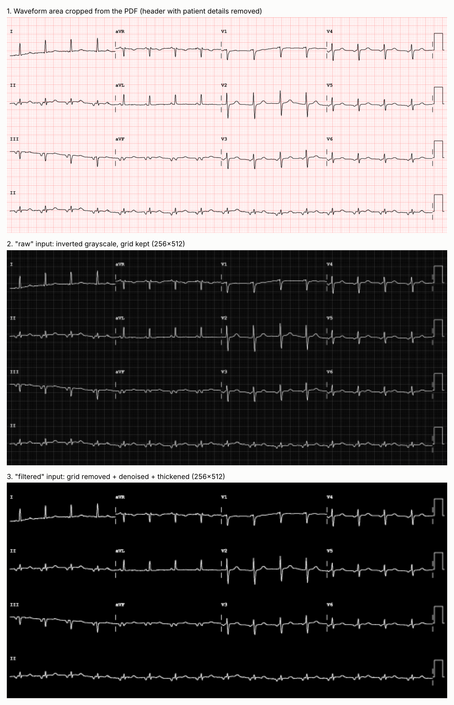
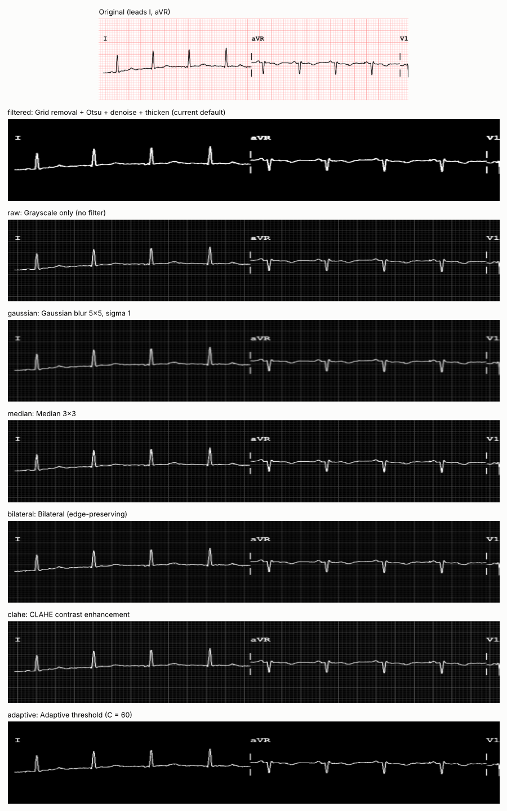
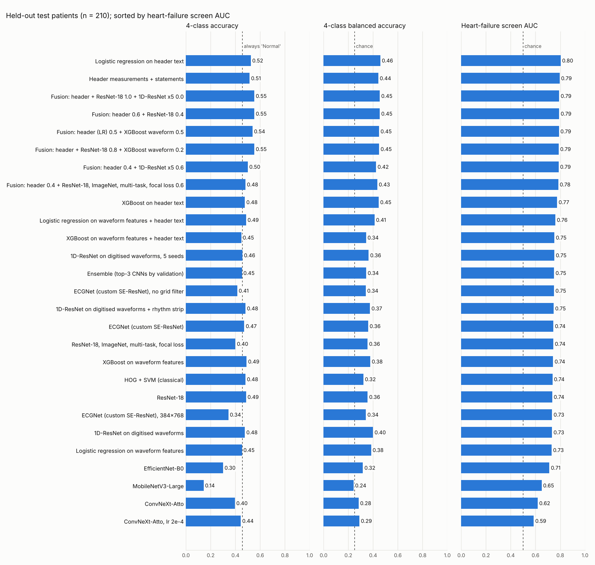
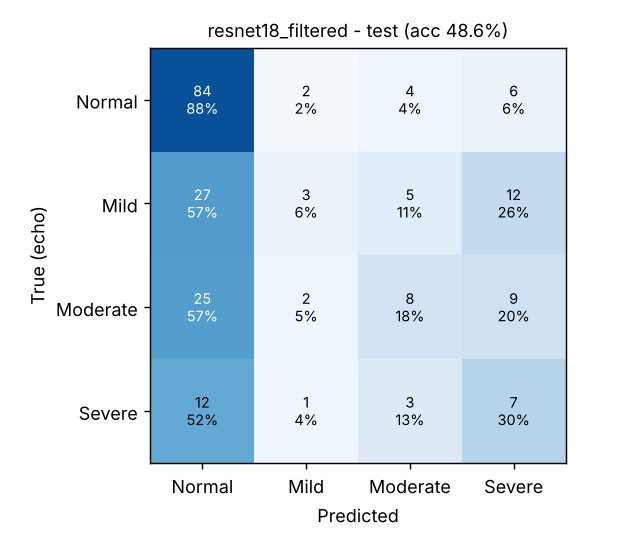
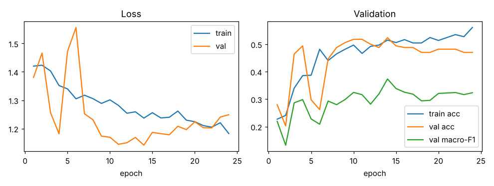
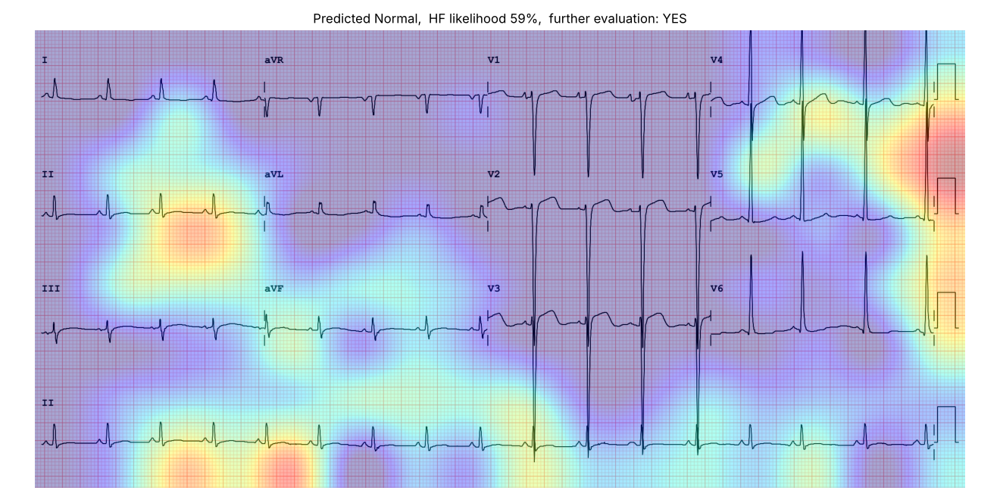
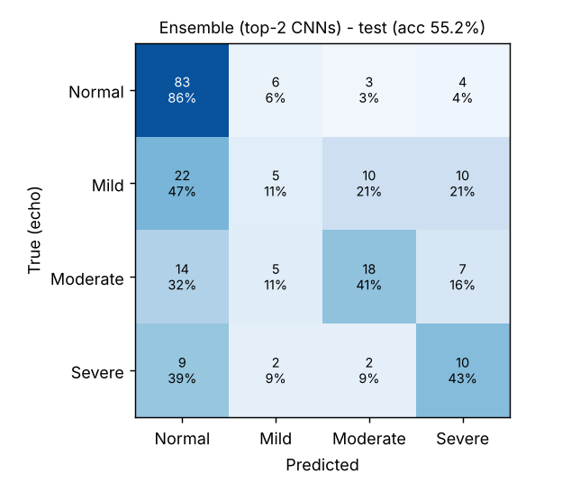

# ECG image → LVEF category & heart-failure screening (12-lead, CNN)

A deep-learning pipeline that takes a **12-lead ECG image** (the PDF printout from the
ECG machine, or a PNG/JPG of it) and predicts:

1. the **Left-Ventricular Ejection Fraction (LVEF) category** – **Normal / Mild / Moderate / Severe**, and
2. the **likelihood of heart failure (reduced EF)** with a simple **YES / NO – needs further cardiac evaluation** decision.

It is meant as an automated, non-invasive *preliminary screening* aid that flags
patients who should get an echocardiogram / cardiology review. It is **not** a
diagnostic device.

```
$ python -m ecg_ef.predict "LV_ECG_Dataset_2020/Severe/EK__[20200914112110]_….pdf"
model: Fusion: header 0.6 + ResNet-18 0.4  (1 network(s) + header model (weight 0.6)); category by argmax decoding; further-evaluation threshold: HF likelihood >= 49%

  LVEF category           : Moderate      probabilities: Normal 23%  Mild 18%  Moderate 45%  Severe 14%
  Heart-failure likelihood: 77%
  Further evaluation      : YES - moderately reduced EF; cardiology evaluation and treatment advised
  (based on image + header; threshold 49%)
```
*(Real output for a held-out test ECG whose echo showed severely reduced EF. The image
CNN alone called it "Normal" with a 59 % heart-failure likelihood. With the header
measurements added, it is flagged at 77 % and called Moderate: closer, but still one
category off. See Results.)*

> **Bottom line of the experiments (details in §4–5):** the default pipeline combines the
> image CNN with the measurements and statements printed in the ECG header. On held-out
> patients it separates *reduced* from *normal* EF with **AUC 0.79** (95 % CI 0.73–0.85)
> and reaches **55 % 4-class accuracy / 0.45 balanced accuracy**. The image CNN alone
> gets AUC 0.735 and 49 % / 0.36. That gain is statistically significant
> (paired bootstrap, §5). The 4-class category is still the weak part: Mild and Moderate
> are often called Normal.

---

## 1. Dataset

`LV_ECG_Dataset_<year>/<class>/*.pdf` – one 12-lead ECG per PDF (25 mm/s, 10 mm/mV,
3×4 layout + lead-II rhythm strip). The folder name is the label, derived from the
patient's echocardiogram (EF by Teichholz), using the ECG–echo matching notebook (`ECG_ECHO/`, since removed from the repository):

| Class    | EF definition (ASE)                         | 2020 | 2021 | 2022 | 2024 | Total |
|----------|---------------------------------------------|-----:|-----:|-----:|-----:|------:|
| Normal   | EF > 52 % (male) / ≥ 54 % (female)          | 120  | 120  | 120  | 120  | 480 |
| Mild     | EF 41–52 % (male) / 41–53 % (female)        | 48   | 74   | 42   | 68   | 232 |
| Moderate | EF 31–40 %                                  | 36   | 69   | 43   | 73   | 221 |
| Severe   | EF < 31 %                                   | 28   | 31   | 21   | 34   | 114 |
|          |                                             | 232  | 294  | 226  | 295  | **1,047** |

**Train / validation / test split – by patient.** 993 unique patients; 48 have more
than one ECG (32 of them in different classes). A random image split would put the
same person in train and test and inflate accuracy, so the split is
`StratifiedGroupKFold` grouped on the (hashed) patient name and stratified by class:

| split | Normal | Mild | Moderate | Severe | total |
|-------|------:|-----:|--------:|------:|------:|
| train | 307 | 148 | 141 | 73 | 669 |
| val   | 77  | 37  | 36  | 18 | 168 |
| test  | 96  | 47  | 44  | 23 | 210 |

The split is saved in [`results/split.csv`](results/split.csv) (ECG id + label only).

## 2. Image preprocessing & filters (`ecg_ef/preprocess.py`)



| Step | What / why |
|------|------------|
| **Render** | The PDFs are vector graphics; the page is rasterised at 1 px/pt. All 1,047 files share the same layout (grid at y = 547–1697 pt), so one crop works for all. |
| **Crop to waveforms** | Keeps only the 12-lead area. This **removes the header** (patient name/age/sex *and* the machine's printed interpretation such as "LBBB" or "anterior infarct"), so the network must learn from the waveforms themselves and cannot read the answer from text. |
| **Grid-removal filter** | `darkness = 255 − max(R,G,B)` (HSV value). Pink/red grid lines have a high value, the black trace a low one, so the grid disappears. Works for any coloured grid, so also for scans/photos. |
| **Otsu threshold** | Adaptive (clamped) binarisation of the trace. |
| **Denoise** | Removes connected components < 6 px (scanner speckle, grid crossings) without eroding thin trace lines (a median/opening filter would). |
| **Thicken** | Scale-aware dilation so 1-px lines survive down-sampling. |
| **Resize** | Area (anti-aliased) interpolation to 512×1024 cache → 256×512 network input. |

### 2.1 Preprocessing-filter comparison

To test which filter helps the CNN most, `preprocess.py` can build **7 image variants**
of every ECG (`python -m ecg_ef.preprocess --variants all`). Each filter is applied at
full resolution and then area-resized, so only the filter differs:

| Variant | Filter | Purpose |
|---|---|---|
| `filtered` (default) | colour grid removal + Otsu + speckle removal + thickening | trace only, no grid |
| `raw` | grayscale only | no-filter reference |
| `gaussian` | Gaussian blur 5×5, σ 1 | remove image noise |
| `median` | median 3×3 | remove salt-and-pepper noise |
| `bilateral` | bilateral filter (d 7, σ 50/7) | smooth background, keep trace edges |
| `clahe` | CLAHE (clip 2.0, 8×8 tiles) | enhance trace contrast |
| `adaptive` | adaptive Gaussian threshold (block 25, C 60) | separate trace from grid without colour; C = 60 drops the darker grid lines |



The Colab notebook trains the same pretrained CNN (ConvNeXt-Atto) once per variant
(Part B). Run it to fill in this comparison.

**Augmentation (training only, `ecg_ef/data.py`)** – small rotation (±2°), independent
time/amplitude scaling (±6 % / ±10 %, i.e. paper-speed and gain differences),
translation (±3 %) and random erasing of a narrow time segment (lead-off artefact).
**No flips**: a horizontal flip reverses time and a vertical flip inverts every
lead's polarity – both change the diagnosis.

## 3. Models compared

| Model | Type | Params |
|-------|------|------:|
| **HOG + SVM** | classical baseline: histogram-of-oriented-gradients features → PCA(150) → RBF-SVM | – |
| **ECGNet** (`ecg_ef/models.py`) | custom residual CNN for ECGs: 7×7 stem, 4 stages of residual blocks with **time-elongated 3×5 kernels** and **squeeze-excitation channel attention**, **global average + max pooling** head (max-pool keeps strong local evidence such as one abnormal QRS), dropout | 6.3 M |
| **ResNet-18** | standard residual CNN (timm) | 11.2 M |
| **EfficientNet-B0** | compound-scaled MBConv + SE (timm) | 4.0 M |
| **ConvNeXt-Atto** | modern "ConvNet for the 2020s" design (timm) | 3.4 M |
| **MobileNetV3-Large** | lightweight inverted-residual CNN (timm) | 4.2 M |
| **VGG16** ¹ | plain deep stack of 3×3 convolutions | 134 M |
| **ResNet-34 / ResNet-50** ¹ | deeper residual networks | 21 M / 23.5 M |
| **DenseNet-121** ¹ | dense connections, feature reuse | 7.0 M |
| **MobileNetV2** ¹ | lightweight inverted-residual CNN | 2.2 M |
| **InceptionV3** ¹ | parallel multi-scale convolutions | 21.8 M |
| ECGNet on **raw** images | same network, no grid filter – *filter ablation* | 6.3 M |
| ECGNet at **384×768** | same network, 2.25× more pixels – *resolution ablation* | 6.3 M |
| **Ensemble** | soft voting: mean of the class probabilities of the 3 CNNs with the best *validation* score (`ecg_ef/ensemble.py`) | – |

All CNNs take a 1-channel 256×512 image (unless stated). The results in §4–5 are for
networks trained **from scratch** in this environment. ¹ These architectures, and all
models with **ImageNet-pretrained weights** (`--pretrained`), are trained in the Colab
notebook (§7), which has a GPU and internet access.

**Training** (`ecg_ef/train.py`): AdamW (lr 1e-3, wd 0.05), 2-epoch warm-up + cosine
schedule, batch 16, ≤ 30 epochs, early stopping (patience 10).
Class-weighted cross-entropy (inverse class frequency – Severe is only 11 % of the data)
with label smoothing 0.05. An **exponential moving average (EMA) of the weights** is
evaluated and saved – with ~670 training images the raw weights swing a lot from epoch
to epoch. The checkpoint is chosen on the **validation** set by
`score = mean(macro-F1, quadratic-weighted κ, heart-failure AUC)`, from epoch 8 on (so a
lucky early epoch can't win). The test set is used once, at the end.

### Decision rules

* **4-class category.** Two rules are reported:
  *argmax* (most probable class) and *ordinal decoding*: the expected severity
  `s = Σ k·P(k)` (Normal = 0 … Severe = 3) is cut into four bands with three cut-points
  fitted on the validation set (macro-F1). Argmax almost never outputs Mild or Moderate –
  their probability is shared with the neighbouring classes – whereas the ordinal rule
  uses the fact that the classes are ordered. `predict.py` uses ordinal decoding.
* **Heart-failure likelihood** = `P(Mild) + P(Moderate) + P(Severe)` = `1 − P(Normal)`,
  i.e. the probability that EF is reduced (≤ 52–53 %).
  **Further evaluation = YES** when the likelihood is above a threshold chosen on the
  validation set to give **≥ 80 % sensitivity** – for screening, missing a patient with
  low EF is worse than one extra echo.

## 4. Results

Held-out **test set: 210 ECGs from 199 patients** never seen during training or model
selection. Full numbers: [`results/comparison.md`](results/comparison.md) /
[`.csv`](results/comparison.csv); per-model metrics, training curves, confusion matrices
and predictions in `results/<model>/`.



*The chart also includes the waveform, header and fusion models of §5. Dashed lines: what a model with no information scores (always "Normal" = 45.7 %
accuracy, because 96 / 210 test ECGs are Normal; 0.25 balanced accuracy; 0.5 AUC).*

### 4.1 Heart-failure screening – reduced EF (Mild/Moderate/Severe) vs Normal

| Model | AUC (95 % CI) | Sensitivity | Specificity | EF ≤ 40 % AUC | Params (M) | CPU train (min) |
|-------|---------------|-----:|-----:|-----:|-----:|-----:|
| Ensemble (top-3 CNNs by validation) | **0.750** (0.68–0.81) | 0.71 | 0.59 | 0.705 | – | – |
| ECGNet, no grid filter | **0.749** (0.68–0.81) | 0.75 | 0.57 | 0.694 | 6.3 | 20.7 |
| ECGNet | **0.745** (0.68–0.81) | 0.71 | 0.62 | 0.703 | 6.3 | 21.0 |
| HOG + SVM (classical) | **0.737** (0.67–0.80) | 0.82 | 0.47 | 0.725 | – | 1.2 |
| **ResNet-18** (selected) | **0.735** (0.66–0.80) | 0.72 | 0.61 | 0.697 | 11.2 | 23.5 |
| ECGNet, 384×768 | **0.734** (0.66–0.80) | 0.72 | 0.54 | 0.699 | 6.3 | 49.4 |
| EfficientNet-B0 | **0.712** (0.64–0.78) | 0.71 | 0.65 | 0.659 | 4.0 | 35.5 |
| MobileNetV3-Large | **0.649** (0.57–0.72) | 0.82 | 0.39 | 0.616 | 4.2 | 12.0 |
| ConvNeXt-Atto | **0.618** (0.54–0.70) | 0.73 | 0.35 | 0.627 | 3.4 | 18.5 |
| ConvNeXt-Atto, lr 2e-4 | **0.586** (0.51–0.66) | 0.81 | 0.26 | 0.540 | 3.4 | 16.2 |

Sensitivity/specificity are at each model's threshold chosen on the validation set for
≥ 80 % sensitivity; on the test set sensitivity lands at 71–82 %.

### 4.2 Four-class LVEF category (Normal / Mild / Moderate / Severe)

| Model | Accuracy (95 % CI) | Balanced acc. | Macro-F1 | QWK | Balanced acc. *(ordinal)* | Macro-F1 *(ordinal)* |
|-------|----------|-----:|-----:|-----:|-----:|-----:|
| Ensemble (top-3 CNNs by validation) | 0.452 (0.38–0.52) | 0.344 | 0.262 | 0.377 | 0.319 | 0.314 |
| ECGNet, no grid filter | 0.414 (0.35–0.48) | 0.340 | 0.276 | 0.342 | 0.326 | 0.326 |
| ECGNet | 0.471 (0.41–0.53) | **0.360** | 0.262 | **0.389** | 0.330 | 0.320 |
| HOG + SVM (classical) | 0.481 (0.41–0.55) | 0.322 | 0.283 | 0.229 | **0.413** | **0.406** |
| **ResNet-18** (selected) | **0.486** (0.42–0.55) | 0.356 | **0.323** | 0.290 | 0.322 | 0.315 |
| ECGNet, 384×768 | 0.343 (0.28–0.41) | 0.342 | 0.229 | 0.237 | 0.366 | 0.360 |
| EfficientNet-B0 | 0.300 (0.24–0.36) | 0.318 | 0.236 | 0.130 | 0.333 | 0.332 |
| MobileNetV3-Large | 0.143 (0.10–0.19) | 0.243 | 0.111 | 0.062 | 0.304 | 0.304 |
| ConvNeXt-Atto | 0.395 (0.33–0.46) | 0.283 | 0.262 | 0.249 | 0.310 | 0.301 |
| ConvNeXt-Atto, lr 2e-4 | 0.443 (0.37–0.51) | 0.289 | 0.262 | 0.089 | 0.288 | 0.279 |
| *always "Normal"* | *0.457* | *0.250* | *0.157* | *0* | | |

QWK = quadratic-weighted Cohen's κ (penalises Normal→Severe errors more than
Normal→Mild).

### 4.3 What the comparison shows

1. **Screening works modestly; the 4-class category does not (yet).** The best models
   separate reduced from normal EF with AUC ≈ 0.75. For the four categories, accuracy is
   at the "always Normal" level and balanced accuracy is only 0.34–0.36 (chance 0.25):
   the models learned "normal vs clearly abnormal", not the fine EF bands.
2. **No model is clearly best.** The top six are within 0.016 AUC of each other, with
   overlapping 95 % CIs of ±0.07, and the classical **HOG + SVM is as good as the CNNs**.
   With 669 training images and no pretraining, the deep networks don't have enough data
   to beat hand-crafted edge features.
3. **Large ImageNet architectures trained from scratch did worst.** EfficientNet-B0 and
   MobileNetV3 trained unstably. ConvNeXt never left chance-level training loss in 30
   epochs, at either learning rate (its residual "layer scale" starts at 1e-6 and needs
   much longer schedules or pretrained weights). The compact ResNet-style models
   (ResNet-18, the custom ECGNet) were the most reliable.
4. **Grid filter:** on these clean, digitally generated PDFs, removing the grid improved
   4-class accuracy (0.47 vs 0.41) and QWK (0.39 vs 0.34) but not the screening AUC. The
   grid is identical in every file, so a CNN can learn to ignore it. Expect the filter
   to matter more for scanned or photographed ECGs with varying grids.
5. **Higher resolution did not help** (384×768: AUC 0.734 vs 0.745). The bottleneck is
   data and labels, not pixels.
6. **Ordinal decoding** raises Mild/Moderate recall (ECGNet Moderate recall 0.02 → 0.41)
   but drops Severe recall from 0.30–0.52 to 0.04 for the CNNs, so it is **off by default**
   (`--decoding ordinal` to use it).
7. **Ensembling** the three best CNNs gave the highest AUC (0.750), but the gain is
   within noise.

### 4.4 Best image-only model – ResNet-18

Best **validation** score among the image CNNs. It is also the image part of the
default pipeline (§5) and is used on its own for PNG/JPG input or with `--no-header`.

| Test (n = 210) | |
|---|---|
| Further evaluation = YES if HF likelihood ≥ 38 % | sensitivity **72 %**, specificity **61 %**, PPV 69 %, NPV 65 % (TP 82, FN 32, FP 37, TN 59) |
| 4-class (argmax) | accuracy 48.6 %; recall Normal 88 %, Mild 6 %, Moderate 18 %, Severe 30 % |
| Accuracy by year | 2020: 55 %, 2021: 42 %, 2022: 61 %, 2024: 41 % |

 

**Grad-CAM** (`--gradcam`) for the Severe test ECG in the example at the top:



The heat-map is coarse (8×16 cells). It highlights V4–V5 and lead II, but also the
**calibration pulses** at the right edge. Those carry no cardiac information, so this is
a warning that the model may be partly using non-physiological cues.

## 5. Increasing accuracy – what worked

All experiments use only the PDFs in `LV_ECG_Dataset_*/` and their folder labels, with
the same patient-grouped split, selection rule and test set as §4.

### 5.1 Two extra inputs from the same PDF

**(a) Digitised waveforms → 1-D CNN** (`ecg_ef/signals.py`, `ecg_ef/train1d.py`).
The PDFs are vector drawings, so each lead's trace is stored as an exact polyline.
`signals.py` reads it back as a real signal (12 leads × 2.5 s, plus the 10-s rhythm
strip), in mV at 500 Hz, using the 82-pt = 1 mV calibration pulse. There is no grid
and no pixel loss. A 1-D SE-ResNet (kernel 9, `[GAP ‖ GMP]` head) trains on it in about
3 minutes per seed on CPU, against 20–50 minutes for the image CNNs.

**(b) Header measurements + machine statements** (`ecg_ef/header.py`). The text layer
of every PDF holds age, sex, the machine's measurements (Rate, RR, PR, QRSD, QT, QTc,
P/QRS/T axis), its verdict (NORMAL / BORDERLINE / ABNORMAL ECG) and 371 distinct
diagnostic statements. 90 of the statements are used, those seen in at least 5 training
ECGs. The patient's name is never read. A regularised logistic regression is fitted on
these 110 features. This also gives the model the patient's **sex**, which sets the
Normal/Mild EF cut-off (52 vs 54 %). The features weighted most towards reduced EF are
the *ABNORMAL ECG* verdict, **QRS duration**, age, *LEFT BUNDLE BRANCH BLOCK*,
*prolonged QT* and *anteroseptal infarct* statements, all clinically plausible. A
"baseline wander" statement also ranks high, a quality cue that is probably spurious.

**(c) Fusion** (`python -m ecg_ef.ensemble --members header_logreg <model> --tune-weight`):
`w·P_header + (1−w)·P_model`, with *w* chosen on the validation set.

### 5.2 Results (same 210 test ECGs)

| Model | Input | Accuracy | Balanced acc. | Macro-F1 | QWK | HF AUC (95 % CI) | Sens. / Spec. | EF ≤ 40 % AUC |
|-------|-------|-----:|-----:|-----:|-----:|------|------|-----:|
| ResNet-18 (§4, image only) | image | 0.486 | 0.356 | 0.323 | 0.290 | 0.735 (0.66–0.80) | 0.72 / 0.61 | 0.697 |
| 1D-ResNet, 1 seed | waveform | 0.476 | 0.400 | 0.385 | 0.373 | 0.734 (0.66–0.80) | 0.75 / 0.57 | 0.754 |
| 1D-ResNet, 5 seeds averaged | waveform | 0.457 | 0.364 | 0.358 | 0.410 | 0.752 (0.68–0.81) | 0.78 / 0.48 | **0.756** |
| 1D-ResNet + rhythm strip | waveform | 0.481 | 0.375 | 0.378 | 0.421 | 0.747 (0.68–0.81) | 0.85 / 0.43 | 0.737 |
| Header features (logistic reg.) | header text | 0.514 | 0.442 | 0.421 | 0.422 | **0.795** (0.73–0.85) | 0.82 / 0.54 | 0.722 |
| Fusion header 0.4 + 1D-ResNet ×5 0.6 | header + waveform | 0.500 | 0.424 | 0.399 | **0.463** | 0.787 (0.72–0.84) | 0.82 / 0.53 | **0.768** |
| **Fusion header 0.6 + ResNet-18 0.4** ⭐ | header + image | **0.552** | **0.454** | **0.433** | 0.447 | 0.791 (0.73–0.85) | **0.82 / 0.56** | 0.733 |

**Is the gain real?** Paired bootstrap over the same test ECGs (2,000 resamples);
difference vs the image-only ResNet-18, with 95 % CI:

| vs ResNet-18 | Accuracy | Balanced acc. | Macro-F1 | HF AUC |
|---|---|---|---|---|
| 1D-ResNet ×5 | −0.029 (−0.10, +0.04) | +0.008 (−0.07, +0.09) | +0.035 (−0.05, +0.12) | +0.018 (−0.03, +0.07) |
| Header features | +0.029 (−0.04, +0.10) | **+0.086** (+0.01, +0.17) | **+0.099** (+0.02, +0.18) | **+0.060** (+0.01, +0.12) |
| **Fusion header + ResNet-18** | **+0.067** (+0.01, +0.12) | **+0.097** (+0.02, +0.18) | **+0.110** (+0.03, +0.19) | **+0.057** (+0.03, +0.09) |
| Fusion header + 1D-ResNet | +0.014 (−0.06, +0.08) | +0.068 (−0.01, +0.15) | +0.076 (−0.01, +0.16) | **+0.052** (+0.01, +0.10) |

Bold = the 95 % CI excludes 0.

**Take-aways**

1. **The header information is the largest, statistically significant gain.** Adding it
   to the image CNN improves all four metrics (accuracy +6.7 points, balanced accuracy
   +9.7, macro-F1 +11, HF AUC +0.06).
2. **The digitised-waveform 1-D CNN** matches or beats the image CNNs at 1/7 of the
   training time, and gives the best EF ≤ 40 % AUC (0.76). Its gains over ResNet-18 are
   **not** statistically significant at this test size, though.
3. **Mild vs Normal is still the hard part.** Even the best model recognises 11 % of
   Mild (most go to Normal), 41 % of Moderate and 43 % of Severe. 80 % of predictions are
   within one category of the truth.

### 5.3 Default pipeline – header + ResNet-18 fusion

`compare.py` selects it by **validation** score (0.612, the highest):
[`results/best_model.json`](results/best_model.json) → `models/resnet18_filtered.pt` +
`models/header_logreg.joblib`, header weight 0.6. `predict.py` uses it automatically for
PDF input. For PNG/JPG input (no text layer) or with `--no-header`, it falls back to the
image-only ResNet-18 with that model's own threshold.

| Test (n = 210) | |
|---|---|
| Further evaluation = YES if HF likelihood ≥ 49 % | sensitivity **82 %**, specificity **56 %**, PPV 69 %, NPV 73 % (TP 94, FN 20, FP 42, TN 54) |
| 4-class (argmax) | accuracy **55.2 %**; recall Normal 86 %, Mild 11 %, Moderate 41 %, Severe 43 % |
| Accuracy by year | 2020: 52 %, 2021: 53 %, 2022: 63 %, 2024: 53 % |



### 5.4 What else would raise accuracy (not possible in this environment)

* **ImageNet-pretrained weights** for the image CNNs
  (`python -m ecg_ef.train --model resnet18 --pretrained`). This environment's network
  policy blocks `huggingface.co` and `download.pytorch.org`.
* **More ECGs**, especially Mild / Moderate / Severe. Published AI-ECG low-EF models
  used tens of thousands of ECG–echo pairs; e.g. Attia et al., *Nature Medicine* 2019,
  trained on ~36 k pairs and reached AUC 0.93 for EF ≤ 35 %. Here: 669 training ECGs.
* **k-fold cross-validation ensembles**, which also train on the validation ECGs and
  give tighter estimates than one 210-ECG test set. They are cheap with the 1-D model.

### 5.5 How this compares with published studies

Only studies that could be confirmed are listed (title, journal and headline numbers
checked against the publisher, PubMed or arXiv records):

| Study | Input | Data | Task | Reported result |
|---|---|---|---|---|
| Attia et al., *Nature Medicine* 2019 ([doi](https://doi.org/10.1038/s41591-018-0240-2)) | ECG signals | ~36 k ECG–echo pairs | EF ≤ 35 % vs > 35 % | AUC 0.93; accuracy 85.7 %, sens. 86.3 %, spec. 85.7 % |
| Sun et al., *J Cardiovasc Electrophysiol* 2021;32:1095–1102 ([PubMed](https://pubmed.ncbi.nlm.nih.gov/33565217/)) | ECG, CNN | 26,786 ECG–echo pairs | LVEF ≤ 50 % vs > 50 % | accuracy 73.9 %, sens. 69.2 %, spec. 70.5 % |
| Vaid et al., *JACC Cardiovasc Imaging* 2022;15:395–410 ([doi](https://doi.org/10.1016/j.jcmg.2021.08.004)) | ECG signals | 761,510 ECGs, 148,227 patients | 3 LVEF classes (≤ 40, 40–50, > 50 %) | AUC 0.94 / 0.82 / 0.89 (internal test); accuracy not reported |
| Sangha et al., *Circulation* 2023;148:765–777 ([doi](https://doi.org/10.1161/CIRCULATIONAHA.122.062646)) | **ECG images** | multi-site | LVEF < 40 % | AUROC 0.91 internal, 0.90–0.95 external |
| Boribalburephan et al., *Scientific Reports* 2024;14:7523 ([doi](https://doi.org/10.1038/s41598-024-58131-6)) | **ECG images** (multi-task CNN) | 14,052 ECGs, cardiac-MRI labels | LVEF < 50 % | AUC 0.939 |
| Carter et al., *Eur Heart J Digit Health* 2022;3(4) ESC Congress abstract ztac076.2778 | ECG signals, 8-layer CNN | 60,169 ECG–echo pairs, 30,153 patients | **3 classes** (≤ 35, 36–51, ≥ 52 %) | AUROC 0.941 for ≤ 35 %; sens. 87.9 %, spec. 86.3 %, accuracy 86.4 % |
| Swamy et al., *Indian Heart Journal* 2025;77:182–187 ([doi](https://doi.org/10.1016/j.ihj.2025.03.009)) | **ECG images**, DenseNet-121 | 119,281 ECG–echo pairs | EF < 50 % | AUROC 0.92 internal / 0.88 external; **accuracy 83.83 % / 77.33 %** |
| Ning et al., arXiv 2604.25942 (2026) ([arXiv](https://arxiv.org/abs/2604.25942)) | ECG features + EHR, XGBoost | 36,784 ECG–echo pairs | **4 classes** (≥ 50, 40–50, 30–40, < 30 %) | one-vs-rest AUROC: normal 0.91, mild 0.82, moderate 0.92, severe 0.95; F1 of the reduced-EF classes only 0.27–0.35 |
| **This project** (header + ResNet-18 fusion) | ECG images + header text | **669** training ECGs | **4 classes** | accuracy 0.55; one-vs-rest AUROC normal 0.79, mild 0.53, moderate 0.73, severe 0.70 |

What the comparison shows:

* **Every published image-based study is binary** (EF < 40 % or < 50 % vs the rest) and
  trained on 14 k–119 k ECGs, 20–180× more than here. None reports 4-class accuracy
  from ECG images.
* The **only 4-class study** uses ECG signal features plus health-record data. Even
  there, **Mild is the hardest class** (AUROC 0.82). Here Mild is at chance level
  (0.53), consistent with having ~150 Mild training ECGs.
* Accuracy and AUROC are different measures, and the studies use different thresholds
  and datasets, so the numbers cannot be compared one-to-one.

All figures above were checked against the papers' full text (the four PDFs in this
project's references) or their publisher / PubMed / arXiv records.

### 5.6 Methods from the reference papers, tested on this data

Each method was taken from one of the reference papers and tested on the same split,
selection rule and 210 test ECGs (CPU only):

| Paper | Method tried here | Test accuracy | Macro-F1 | QWK | HF AUC |
|---|---|---:|---:|---:|---:|
| – | **Current default: header + ResNet-18 fusion** (§5.3) | **0.552** | **0.433** | 0.447 | **0.791** |
| Ning 2026 | **Engineered ECG features** (`ecg_ef/ecg_features.py`: 0.5 Hz high-pass, R-peak-aligned median beats, R/S/ST/T amplitudes, QRS area, spectral entropy, band powers, RR/HRV, Sokolow-Lyon, Cornell) + **XGBoost** (`ecg_ef/tabular.py`) | 0.490 | 0.373 | 0.382 | 0.742 |
| Ning 2026 | XGBoost on waveform features **+ header** (age, sex, measurements – the "EHR" part) in one model | 0.448 | 0.340 | 0.363 | 0.752 |
| Ning 2026 | Header logistic regression + waveform XGBoost, fused (validation weight 0.5) | 0.538 | 0.436 | **0.482** | 0.789 |
| Boribalburephan 2024 + Swamy 2025 | Pretrained ResNet-18 with **multi-task heads** (EF reduced? EF ≤ 40 %?) and **focal loss** (γ 0.2) | 0.400 | 0.336 | 0.289 | 0.744 |
| (same) | … fused with the header model | 0.481 | 0.402 | 0.349 | 0.784 |

Paired bootstrap against the default (2,000 resamples of the same test ECGs):

* the **header + waveform-XGBoost fusion is statistically equivalent** (95 % CI of every
  difference includes 0; its QWK +0.035, CI −0.035 to +0.109);
* **waveform XGBoost alone** is worse (accuracy −0.063, CI −0.124 to −0.005; AUC −0.049);
* the **multi-task + focal CNN** is worse on all four metrics (accuracy −0.15, AUC −0.047).

**Why the papers' methods do not transfer:** they were developed on 14,052–119,281 ECGs.
With 669 training ECGs, the 373-feature XGBoost and the multi-task CNN overfit (training
accuracy ~70 % vs ~35–45 % on validation). Some findings do carry over:

* the waveform features that matter most agree with Ning et al.: **V1 spectral entropy**
  and lead-specific amplitude / T-wave features
  ([`results/xgb_waveform/shap_importance.png`](results/xgb_waveform/shap_importance.png));
* lead I R-wave amplitude falls from Normal to Severe in this data too;
* as in Boribalburephan et al., the 2-D image CNN and the 1-D signal model perform
  similarly, and adding patient information (here, via the header) helps.

The default pipeline is therefore unchanged. The fastest way to raise accuracy remains
**more ECGs**, especially Mild, Moderate and Severe (§5.4).

### 5.7 The further-treatment (YES/NO) decision: what changes its accuracy

[`results/binary_comparison.md`](results/binary_comparison.md), from `python -m ecg_ef.binary`
(test set, 210 ECGs; cut-offs chosen on validation):

| Model | Cut-off rule | Accuracy | Sensitivity | Specificity |
|---|---|---:|---:|---:|
| **Default (image + header)** | catch ≥ 80 % of reduced EF (**used**) | **0.705** | **0.825** | 0.562 |
| Default (image + header) | max sensitivity + specificity | 0.714 | 0.570 | 0.885 |
| Default (image + header) | max accuracy | 0.729 | 0.596 | 0.885 |
| Header model trained directly for YES/NO | catch ≥ 80 % | 0.690 | 0.833 | 0.521 |
| Header model trained directly for YES/NO | max sensitivity + specificity | 0.733 | 0.632 | 0.854 |

* Accuracy can be raised to ~73 % only by **moving the cut-off**, and then ~40 % of
  reduced-EF patients are told NO. For screening the default keeps sensitivity ≥ 80 %.
* A model trained only for YES/NO has the highest AUC (0.807 vs 0.791), but the
  difference is within noise (paired bootstrap +0.016, 95 % CI −0.010 to +0.043).
  Waveform XGBoost adds nothing in the fusion (validation weight 0).

## 6. Limitations

* **Small dataset, trained from scratch** (see §5.4).
* **Label noise.** Labels come from matching ECG and echo records by patient name. The ECG and echo may be far apart in time, and Teichholz EF (M-mode)
  is less accurate than Simpson's biplane, especially with regional wall-motion
  abnormalities.
* **Small test set** → wide confidence intervals (about ±0.06 AUC).
* **The header model depends on this ECG machine's text output** (its measurement
  algorithm and statement wording). Other machines would need their own parser and
  re-training.
* **Single centre / single ECG machine**, so external validation is needed.
* **Not a medical device.** A NO does not rule out heart failure, and a YES means
  "get an echocardiogram", not a diagnosis.

## 7. How to run

### Option A – Google Colab (free GPU, internet for pretrained weights)

[](https://colab.research.google.com/github/krithikareddy22/ECG-Image-Based-Prediction-EF-hear-attack-12-Lead/blob/claude/funny-gauss-udlmv0/colab/train_on_colab.ipynb)

1. Open [`colab/train_on_colab.ipynb`](colab/train_on_colab.ipynb) in Colab (badge above),
   signed in with a Google account.
2. **Runtime → Change runtime type → T4 GPU → Save.**
3. **Runtime → Run all.** The notebook clones this repo and builds all 7 image variants
   with the same split. It then fine-tunes from **ImageNet weights** on the GPU:
   * **Part A, architectures:** ResNet-18/34/50, VGG16, DenseNet-121, EfficientNet-B0,
     MobileNetV2, InceptionV3, ConvNeXt-Atto;
   * **Part B, filters:** ConvNeXt-Atto on each preprocessing variant (§2.1).

   It then re-fits the header fusion and prints the comparison tables (accuracy, macro
   precision / recall / F1, one-vs-rest ROC-AUC per class).
4. To skip models trained in an earlier run, set `REUSE_PREVIOUS_RESULTS = True` in
   step 3 and upload that `ecg_results.zip`.
5. At the end it downloads a new `ecg_results.zip` (results + models; the 0.5 GB VGG16
   file is left out). Colab deletes its files when the session ends, so keep this zip.

`train.py` uses the GPU automatically when one is available (`device cuda` in its first
log line).

### Option B – local / any machine


```bash
pip install -r requirements.txt

python -m ecg_ef.preprocess          # render + filter all PDFs, build patient-grouped split (~1 min)
./run_experiments.sh                 # baseline + all CNNs + comparison table (hours on CPU, minutes on GPU)

# or individually
python -m ecg_ef.baseline
python -m ecg_ef.train --model ecgnet --variant filtered
python -m ecg_ef.train --model resnet18 --pretrained      # ImageNet weights (needs internet)
python -m ecg_ef.ensemble                                # top-3 CNNs by validation score

# accuracy improvements (§5)
python -m ecg_ef.signals                                 # digitise waveforms from the PDF vectors (~15 s)
python -m ecg_ef.train1d --seeds 5 --tag resnet1d_x5     # 1-D CNN on the waveforms (~16 min CPU)
python -m ecg_ef.header                                  # header features + logistic regression (~30 s)
python -m ecg_ef.ecg_features                            # engineered waveform features, Ning et al. (~7 min)
python -m ecg_ef.tabular                                 # XGBoost / logistic regression on those features (~2 min)
python -m ecg_ef.train --model resnet18 --pretrained --multitask --focal-gamma 0.2   # paper-style CNN
python -m ecg_ef.ensemble --members header_logreg resnet18_filtered --tune-weight --name fusion_header_resnet18
python -m ecg_ef.compare                                 # results/comparison.{md,csv,png}, picks best model

# predict new ECGs (PDF, PNG or JPG; files or folders) with the selected model
python -m ecg_ef.predict path/to/ecg.pdf
python -m ecg_ef.predict new_ecgs/ --csv predictions.csv --gradcam heatmaps/
python -m ecg_ef.predict ecg.pdf --no-header                            # image CNN only
python -m ecg_ef.predict ecg.pdf --model models/ecgnet_filtered.pt      # a specific image model
python -m ecg_ef.predict ecg.pdf --no-header --decoding ordinal         # ordinal 4-class rule
```

Model names for `--model`: `ecgnet`, `resnet18`, `resnet34`, `efficientnet_b0`,
`densenet121`, `mobilenetv3`, `convnext_atto`. The trained checkpoints of the selected
ResNet-18 and the custom ECGNet are included in `models/`; the others are re-created by
`./run_experiments.sh`.

`--gradcam` saves a heat-map over the ECG showing which leads / beats drove the
prediction (Grad-CAM on the last convolutional layer).

PNG/JPG input: a full-page image of the same printout layout is cropped automatically
(otherwise the image is assumed to be the waveform area only). Use full resolution
(≥ ~2,000 px wide for a full page); low-resolution images shift the probabilities.

### Repository layout

```
ecg_ef/
  config.py      classes, EF ranges, crop box, screening text
  preprocess.py  PDF/image -> filtered trace image; cache, manifest, split
  data.py        in-memory dataset, ECG-safe augmentation, normalisation
  models.py      ECGNet + timm model factory
  metrics.py     accuracy, balanced acc, macro-F1, QWK, HF-screen sens/spec/AUC
  train.py       train + evaluate one model
  baseline.py    HOG + SVM
  signals.py     digitise the 12-lead waveforms from the PDF vector paths
  train1d.py     1-D SE-ResNet on the digitised waveforms
  header.py      header measurements/statements -> features + logistic regression
  ecg_features.py engineered waveform features (after Ning et al. 2026)
  tabular.py     XGBoost / logistic regression on waveform and header features
  ensemble.py    soft-voting ensemble / validation-weighted fusion of models
  compare.py     comparison table / chart, bootstrap CIs, best-model selection (on validation)
  predict.py     inference CLI (image CNN [+ header fusion]) with Grad-CAM
results/         per model: metrics.json, ordinal.json, confusion matrices, training curves,
                 val/test predictions (ECG id = year_timestamp, no patient names)
models/          resnet18_filtered.pt + header_logreg.joblib (default pipeline), ecgnet_filtered.pt
```
